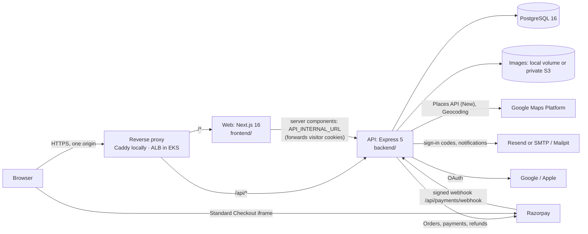

# Architecture

Two deployable processes, one database, one public origin.

## Components

| Component | Code | Responsibility |
|---|---|---|
| Web | `frontend/` | Server-rendered browse and detail pages (SEO, no client secrets), client pages for account, inbox, reporting and moderation. English and Hindi (`lib/i18n`). Light and dark themes (`lf_theme` cookie, set server-side). |
| API | `backend/` | All business rules, authorization, validation, payments, notifications and provider calls. |
| Database | `backend/migrations/*.sql` | PostgreSQL schema, constraints and triggers that enforce invariants (for example, an accepted reward snapshot can't change; at most one live recovery per match). |
| Background work | `backend/server.js` (housekeeping timers in the API process) | Session store prunes expired sessions every 15 minutes. Hourly: purge of old OTP challenges, rate-limit windows and analytics; return reminders (48 h, 7 days); refresh of Google coordinates older than 30 days. |

There is no separate worker or queue. Housekeeping jobs are idempotent and
deduplicated in the database, so running several API replicas is safe.

## Request flow

1. The browser only talks to the web origin. `/api/*` is proxied to the API
   (Next.js rewrite locally; ingress rule in Kubernetes). Cookies are
   first-party and CORS is never needed.
2. Server components fetch from the API over the internal network
   (`frontend/lib/server-api.ts`), forwarding the visitor's cookies, so owners
   and moderators see their own view of a page.
3. In the API, each request passes: request ID → helmet headers → session →
   passport → rate limiter → CSRF (token and origin) → route. Routes
   validate input with zod (`.strict()`, so unknown fields are rejected),
   authorize, then call services inside a transaction where state changes.
4. Errors leave through one handler with a stable `{ error: { code, message } }` shape.

## Authentication and authorization boundaries

| Boundary | Where enforced |
|---|---|
| Signed-in user | `requireUser` (routes). Sessions live in PostgreSQL (`connect-pg-simple`); the ID rotates at sign-in. |
| Poster / claimant / match participant | Inside each route or service, by comparing `req.user.id` with the row's owner, claimant, `owner_id` or `finder_id` after locking the row. |
| Moderator / admin | `requireModerator` for `/moderation/*` and `/admin/*`. Roles are set with `backend/scripts/set-role.js`. |
| Contact access | Messages, phone sharing and handover details require a captured ₹100 payment for that match (`402 connection_locked`). Free-text fields visible before payment reject contact details (`services/contactGuard.js`). |
| Public data | `services/serializers.js` builds responses from an allow-list. Email, phone, precise coordinates and claim answers are never public. |
| Test-only features | `ENABLE_TEST_AUTH` and `PAYMENT_PROVIDER=test` / `PLACES_PROVIDER=fixture` are refused by `loadConfig()` where they would be unsafe. |

## External integrations

Each provider sits behind one adapter in `backend/src/integrations/`:

| Adapter | Provider | Fake for tests |
|---|---|---|
| `places.js` | Google Places API (New) and Geocoding | `fixture` provider with fixed places and failure triggers |
| `payments.js` | Razorpay Orders, Payments, Refunds; HMAC signature checks | `test` provider implementing the same contract (orders, signatures, webhooks) |
| `mailer.js` | Resend HTTP API, or SMTP via nodemailer | Mailpit (SMTP) in compose and e2e |
| `storage.js` | Local disk or S3 (+ CloudFront invalidation) | Local disk |

## Important design decisions

- **The platform charges only the ₹100 connection fee.** The finder reward is
  agreed per match (immutable snapshot on `claims`) and paid directly between
  people. Checkout ignores any client-supplied amount; the server compares the
  provider's amount and currency before unlocking. See [payments.md](payments.md).
- **A return completes only when the owner confirms receipt.** Paying the fee
  or the finder reporting handover does not complete it. One `recoveries` row
  per recovery keeps statistics honest. See [returns.md](returns.md).
- **Google keys never reach the browser.** Location suggestions are proxied;
  stored coordinates are rounded and public distances are banded. See
  [locations.md](locations.md).
- **Configuration is validated once**, at start-up, and reports every problem
  by variable name. Pricing is code, not configuration, so changes are
  reviewed and versioned (`PRICING_VERSION`).
- **Additive migrations** let the previous release run against the new
  schema, which makes rollback a plain image rollback. See [deployment.md](deployment.md).
